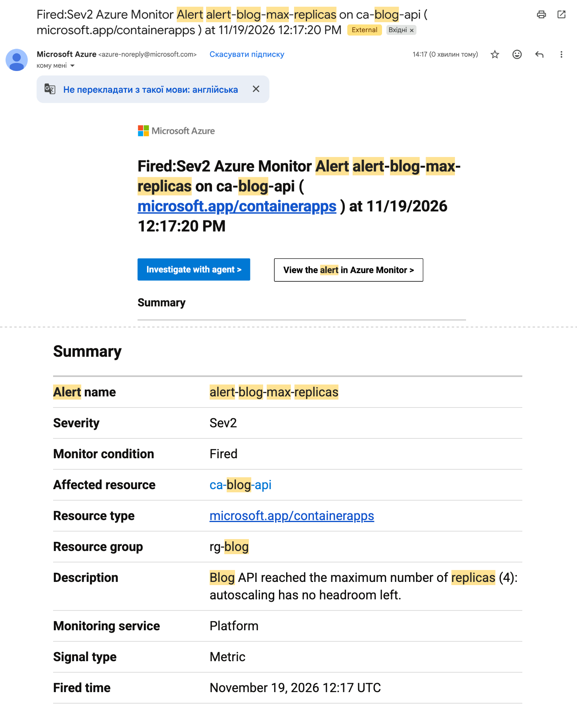
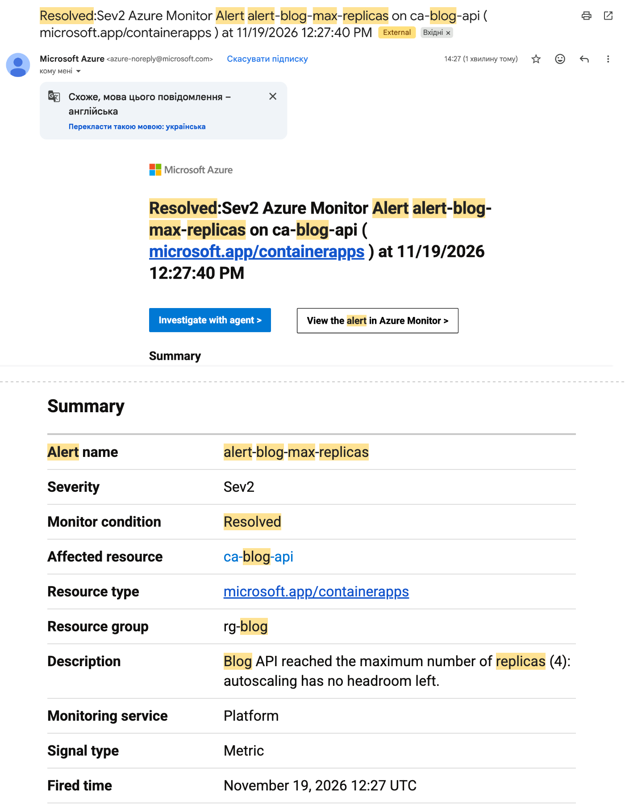

# Lab 2: алерт

Terraform: [`terraform/main/monitoring.tf`](../terraform/main/monitoring.tf).

## Що налаштовано

| Ресурс | Назва | Параметри |
|---|---|---|
| `azurerm_monitor_action_group` | `ag-blog-email` | один отримувач email: `karina.petryk.ir.2024@lpnu.ua`, common alert schema |
| `azurerm_monitor_metric_alert` | `alert-blog-max-replicas` | метрика `Replicas` застосунку `ca-blog-api`, агрегація **Maximum**, умова **>= 4**, вікно `PT1M`, перевірка щохвилини, severity 2, `auto_mitigate = true` |

`auto_mitigate = true` робить алерт **stateful**: він надсилає один лист **Fired**, коли
умова стає істинною, і один лист **Resolved**, коли вона знову хибна. Поки умова
триває, повторних листів немає, тож пошта не засмічується.

Вартість: правило метричного алерту з одним часовим рядом коштує близько $0.10 на місяць,
email-сповіщення в межах 1000 на місяць безкоштовні.

## Чому саме ця умова: «реплік = максимум (4)»

Поки реплік менше 4, автомасштабування саме справляється з ростом навантаження, і
людині втручатися не потрібно. Коли реплік стало 4, **запасу більше немає**: подальший
ріст навантаження означає ріст латентності, а потім і помилки. Це момент, коли людина має
вирішити, що робити: підняти `max_replicas`, оптимізувати код, додати кеш або
масштабувати базу. Тобто алерт сповіщає про ситуацію, яку система не може виправити
сама.

Чому не інші варіанти:

* **CPU > 80% протягом 2 хв.** Під час кожного масштабування CPU на 1-2 хвилини
  перевищує ціль (див. [AUTOSCALING.md](AUTOSCALING.md)), і це нормально: так працює
  автоскейлер. Такий алерт спрацьовував би на кожен пік і привчив би ігнорувати листи.
  До того ж вікно метричного алерту в Azure не може бути 2 хв: дозволені `PT1M`, `PT5M`,
  `PT15M` і довші.
* **p95 латентності.** Container Apps не публікує перцентилі як метрику, тільки
  середнє, мінімум і максимум. p95 рахується з логів через KQL (плитка на дашборді), а
  алерт за логами (log search alert) дорожчий і повільніший: запит виконується за
  розкладом, мінімум раз на 5 хв за базовою ціною.
* **5xx > 0.** Корисний додатковий алерт про відмову, але під час наших прогонів 5xx не
  було жодного. Для лаби потрібна умова, яку навантажувальний тест гарантовано викликає.

`Maximum` за хвилину, а не `Average`: алерт має спрацювати, щойно четверта репліка
з'явилась, навіть якщо вона існувала лише частину хвилини.

## Спершу листи не приходили: адресу треба підтвердити

Під час головного прогону (без кешу) алерт **спрацював**: Azure перевів його у стан
Fired о 05:57:22 і в Resolved о 06:08:17. Так само під час калібрування і прогону з
кешем. Але **жодного листа не прийшло.**

Причина: Azure Monitor вимагає підтвердити кожну нову адресу email у action group.
Одразу після `terraform apply`, який створив `ag-blog-email`, о 05:29 прийшов лист
«Action required: Verify your email for Azure Monitor action group» з одноразовим кодом.
Код діє 30 хвилин, і ми його пропустили. Поки адреса не підтверджена, receiver має
статус `Enabled`, але листи на нього не відправляються. Через API чи `az` стан
верифікації не видно, тільки в порталі (Action group → Overview → Notifications →
*Email verification: Pending*). Це аналог підтвердження підписки SNS в AWS.

Що спробували і що спрацювало:

| Спроба | Результат |
|---|---|
| `az monitor action-group enable-receiver` | `ReceiverAlreadyEnabled`, нового листа немає |
| перейменувати receiver у Terraform (`karina` → `karina-lpnu`, apply) | нового листа немає: верифікація прив'язана до адреси, а не до імені |
| кнопка **Resend** у порталі, *Email verification* | новий лист о 14:06, код введено, статус **Verified** |

Після цього прогін повторено тільки заради листів.

## Перевірка під час навантажувального тесту

`VUS=25 RAMP=1m STEADY=5m DOWN=30s ./loadtest/run.sh alert-email`, 19.11.2026. Той самий
сценарій і N, але коротше наростання, щоб швидше дійти до 4 реплік (27 380 запитів,
0% помилок). Час київський (UTC+2), у дужках UTC.

| Подія | Час |
|---|---|
| Початок тесту | 14:09:16 (12:09:16) |
| Початок сталого навантаження (після 1 хв наростання) | **14:10:16** (12:10:16) |
| Реплік стало 2 | 14:11:24 (12:11:24) |
| Реплік стало 4 | 14:14:15 (12:14:15) |
| Кінець тесту | 14:15:49 (12:15:49) |
| Алерт **Fired** в Azure | 14:17:20 (12:17:20) |
| **Лист Fired отримано** | **14:17** |
| Реплік стало 1 | 14:22:29 (12:22:29) |
| Алерт **Resolved** в Azure | 14:27:40 (12:27:40) |
| **Лист Resolved отримано** | **14:27** |

Лист «Fired» (тема, час отримання 14:17 і зведення з умовою):

Лист «Resolved» (14:27):

Час спрацювання в Azure для попередніх прогонів, коли листи ще не доставлялись: головний
прогін Fired 05:57:22, Resolved 06:08:17; прогін з кешем Fired 11:52:40, Resolved 12:06:39.
Затримки там такі самі (див. нижче).

### Скільки минуло від сталого навантаження до першого листа

Від початку сталого навантаження (14:10:16) до листа Fired (14:17) минуло **~7 хв**.
У головному прогоні від початку сталої фази (05:50:37) до Fired (05:57:22) минуло
6.8 хв, тобто картина повторюється. Складові:

1. **~4 хв: автомасштабування до 4 реплік** (14:10:16 → 14:14:15). Це не затримка
   алерту, а час, за який умова взагалі стала істинною: репліки додаються кроками, і
   кожен крок займає 1-2 хв (пояснення в [AUTOSCALING.md](AUTOSCALING.md#чому-масштабування-вгору-запізнюється)).
2. **~3 хв: від 4 реплік до Fired** (14:14:15 → 14:17:20):
   * платформні метрики потрапляють в Azure Monitor із затримкою 1-3 хв;
   * правило перевіряється раз на хвилину (`frequency = PT1M`) по вікну за останню
     хвилину;
   * сам рушій алертів додає ще десятки секунд.
3. **менше хвилини: від Fired до листа**. Gmail показав 14:17, ту саму хвилину.

Помітно, що **лист Fired прийшов через 1.5 хв після кінця навантаження** (14:15:49).
У головному прогоні так само: Fired о 05:57:22, а тест закінчився о 05:57:38.

Resolved прийшов через ~5 хв після того, як реплік стало 1 (14:22:29 → 14:27:40): та
сама затримка метрики плюс правило Azure для stateful метричних алертів, яке закриває
алерт тільки після **трьох поспіль** перевірок, де умова хибна. Це захищає від
«мерехтіння» Fired/Resolved, коли значення коливається біля порогу.

### Чи прийнятний такий час реакції

Для цього алерту так. Він сигналізує «запас вичерпано», а не «сервіс лежить»: у момент
спрацювання сервіс відповідав без помилок (0% помилок за всі прогони), а латентність
на 4 репліках була найнижчою за тест. Людині, яка отримає лист, потрібні хвилини, щоб
відреагувати, тож 3 хвилини затримки самого алерту нічого не змінюють. Але наші прогони
показали і межу: короткий пік (менше ~5 хв) закінчується раніше, ніж приходить лист. Тобто
такий алерт годиться для тривалого росту навантаження, а не для коротких сплесків.

Для алерту про реальну відмову (5xx, недоступність) 3-6 хвилин забагато. Тоді варто:
* сповіщати по зростанню 5xx з вікном `PT1M`;
* додати перевірку доступності ззовні (availability test Application Insights), яка
  не залежить від затримки платформних метрик;
* замість email використати канал, який читають одразу (SMS, push, Teams, PagerDuty).
