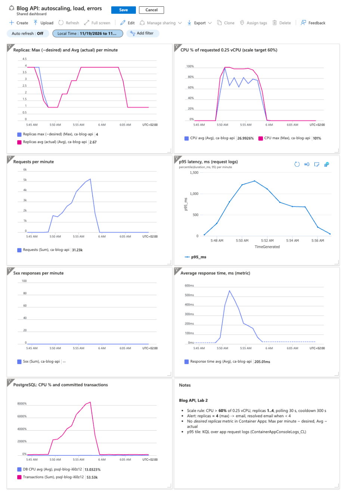
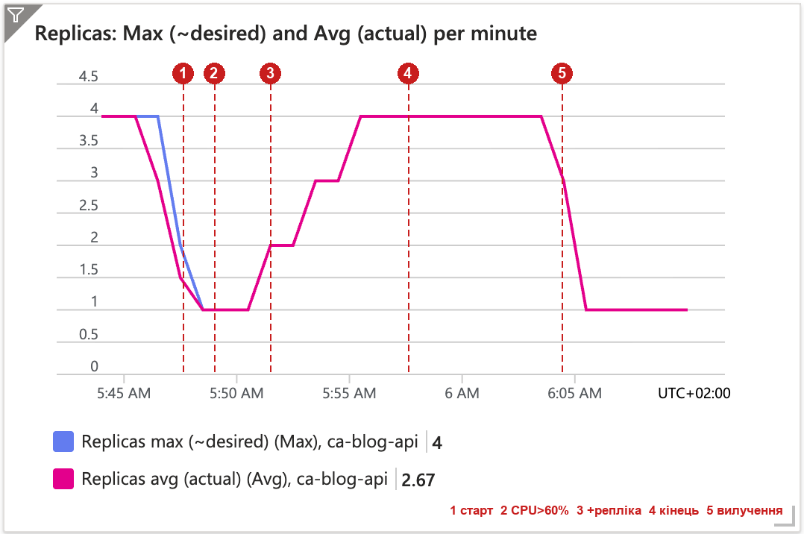
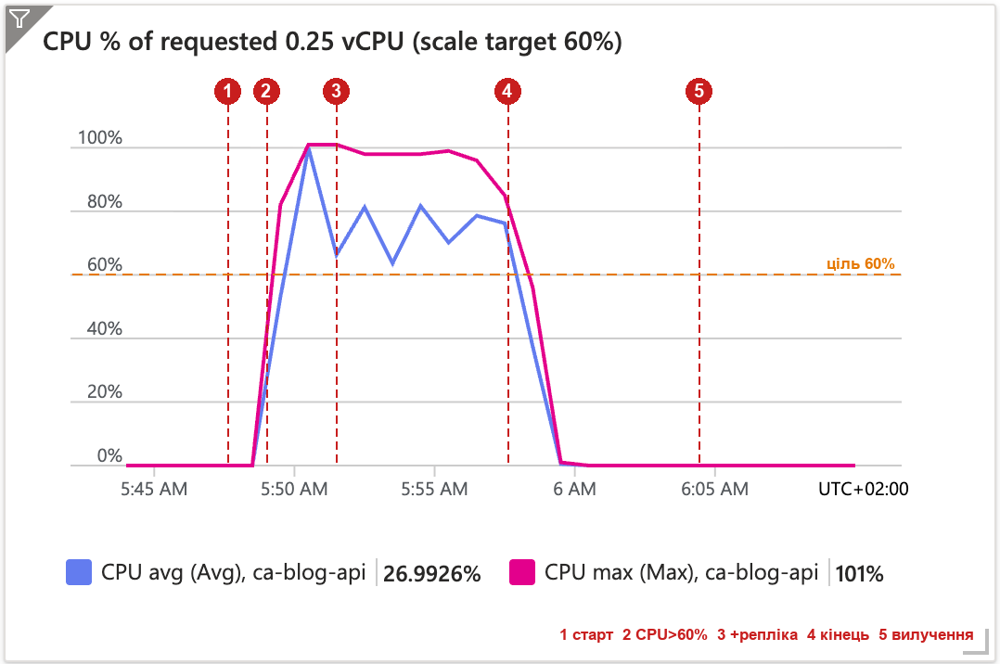

# Lab 2: автоматичне масштабування

## Параметри (Terraform: [`terraform/main/container_app.tf`](../terraform/main/container_app.tf))

| Параметр | Значення | Пояснення |
|---|---|---|
| `min_replicas` | 1 | завжди є хоча б одна «тепла» репліка, без холодного старту |
| `max_replicas` | 4 | стеля з умови лаби; обмежує і вартість, і кількість з'єднань до бази |
| правило | `custom_scale_rule`, тип `cpu`, `Utilization` = **60** | середній CPU реплік відносно запитаних 0.25 vCPU |
| `polling_interval_in_seconds` | 30 | як часто KEDA перевіряє правило |
| `cooldown_period_in_seconds` | 300 | скільки KEDA чекає після останньої активності, перш ніж скорочувати |
| `termination_grace_period_seconds` | 30 | скільки часу репліка має на коректне завершення після SIGTERM |
| ресурси репліки | 0.25 vCPU, 0.5 GiB | |

Як це працює в Azure Container Apps: під капотом **KEDA** читає метрику і передає її
Kubernetes **HPA**, а HPA рахує бажану кількість реплік:

```
бажано = ceil( поточні_репліки × поточний_CPU% / 60% )
```

Приклад з нашого прогону: 1 репліка на 100% → `ceil(1 × 100 / 60)` = 2;
2 репліки на 100% → `ceil(2 × 100 / 60)` = 4.

## Чому ціль саме 60% CPU

* **Запас на час реакції.** Між перетином порогу і моментом, коли нова репліка почне
  приймати трафік, минає 1-2 хвилини (див. нижче). Увесь цей час старі репліки
  тягнуть зростаюче навантаження самі. 40% запасу дозволяють пережити цей проміжок,
  не впираючись у 100%, коли латентність різко росте.
* **CPU обмежений 100%.** Коли репліка вже на 100%, KEDA не бачить, наскільки сильне
  перевантаження, і за один крок збільшує кількість щонайбільше в 100/60 ≈ 1.7 раза.
  Нижча ціль дає більший крок.
* **Не нижче.** При цілі 30% сервіс тримав би вдвічі більше реплік, ніж потрібно:
  платимо за простій, а базі дістається більше з'єднань.
* **Чому CPU, а не кількість запитів.** Калібрування показало, що вузьке місце
  саме в CPU застосунку: при 100% CPU репліки база мала лише 15-19% CPU. Для сервісу,
  який здебільшого чекає на базу, CPU був би поганою метрикою (процес чекає, CPU
  низький, а запити стоять у черзі). Тоді краще правило `http_scale_rule` за
  кількістю одночасних запитів на репліку.

## Бажана і фактична кількість реплік

Умова лаби просить показати на графіку і бажану, і фактичну кількість. **Container Apps
не публікує в Azure Monitor метрику бажаної кількості реплік**: її рахує KEDA/HPA
всередині керованого Kubernetes, а назовні є тільки метрика `Replicas`. У системних
логах (`ContainerAppSystemLogs_CL`) KEDA пише тільки старт і зупинку спостереження за
ревізією, без чисел.

Найближчий аналог на дашборді, плитка *Replicas*:

| Лінія | Агрегація за хвилину | Що означає |
|---|---|---|
| `Replicas max (~desired)` | Maximum | репліка рахується, щойно її заплановано, тобто в момент рішення скейлера. Ця лінія першою стрибає вгору |
| `Replicas avg (actual)` | Average | скільки реплік реально існувало в середньому за хвилину. Відстає від Max на час старту |

Коли Max уже 4, а Avg ще 2.5, це саме момент «бажано 4, фактично ще піднімаються».

## Період стабілізації (cooldown)

**Період стабілізації** це час, протягом якого система не скорочує кількість реплік
після зменшення навантаження. Скорочення відбувається тільки тоді, коли нижча кількість
була достатньою **весь** цей період. У Container Apps діють два механізми:

* `cooldown_period_in_seconds = 300` (KEDA): після останнього активного тригера KEDA
  чекає 300 с, перш ніж скоротити до мінімуму;
* вікно стабілізації HPA на скорочення: 300 с, в Container Apps не налаштовується.
  HPA бере максимальну бажану кількість за останні 5 хвилин.

**Що буде, якщо cooldown = 0.** Кількість реплік почне «смикатися» (flapping): коротке
падіння навантаження, наприклад пауза між хвилями запитів, одразу видаляє репліки, а
наступна хвиля знову їх додає. Наслідки:
* кожне додавання коштує 1-2 хв холодного старту, протягом яких латентність росте;
* запити на репліках, що видаляються, мають встигнути завершитися (graceful shutdown);
  при частому видаленні частина з'єднань рветься;
* з'єднання до бази постійно відкриваються і закриваються;
* через `ceil()` і шум метрики кількість може коливатися навіть при сталому
  навантаженні.

Масштабування вгору затримки стабілізації не має, щоб реагувати на ріст швидко.

## Результати прогону

Головний прогін без кешу: `./loadtest/run.sh no-cache`, N = 25 VU, 19.11.2026,
**05:47:37-05:57:38** за київським часом (03:47:37-03:57:38 UTC). Час нижче київський,
як на дашборді (UTC+2). Звіт k6: [LOADTEST.md](LOADTEST.md#результати).



### Ключові моменти

| # | Момент | Час | Що видно на графіку |
|---|---|---|---|
| 1 | Початок навантаження | **05:47:37** | *Requests per minute* росте з 41 (05:48) до 1651 (05:49) |
| 2 | CPU перетинає ціль 60% | **05:49** | CPU max 82%, avg 53%; о 05:50 avg уже 100% |
| 3 | Новий екземпляр | **05:50:05** 1 → 2, **05:52:14** 2 → 3, **05:54:06** 3 → 4 | *Replicas* сходинками росте до 4 |
| 4 | Кінець навантаження | **05:57:38** | *Requests per minute* падає до нуля |
| 5 | Вилучення екземплярів | **06:03:35** 4 → 3, **06:04:42** 3 → 1 | *Replicas* повертається до 1 |

Секунди моментів 3 і 5 взяті зі списку реплік (`az containerapp replica list`), який
опитувався під час прогону. На графіку з хвилинною гранулярністю ті самі події
припадають на 05:51, 05:53, 05:55 і 06:04, 06:05: метрика `Replicas` з'являється в Azure
Monitor із запізненням близько хвилини.

Номери 1-5 на двох скрінах нижче відповідають рядкам таблиці. Червоні вертикальні лінії
нанесені на знімки з порталу, помаранчева лінія на CPU показує ціль 60%. Azure малює
хвилинну точку посередині хвилини, тому позначки 3 і 5 стоять там, де лінія метрики
доходить до 2 і до 3 реплік.





### Хвилинна хронологія (Azure Monitor)

| Час | CPU avg, % | CPU max, % | Реплік max | Реплік avg | Запитів/хв | Відповідь avg, мс | CPU бази, % |
|---|---|---|---|---|---|---|---|
| 05:48 | 0 | 0 | 1 | 1.0 | 41 | 15 | 10 |
| 05:49 | 53 | 82 | 1 | 1.0 | 1651 | 68 | 13 |
| 05:50 | 100 | 101 | 1 | 1.0 | 1540 | 410 | 11 |
| 05:51 | 66 | 101 | 2 | 2.0 | 1929 | 562 | 14 |
| 05:52 | 81 | 98 | 2 | 2.0 | 2568 | 473 | 15 |
| 05:53 | 64 | 98 | 3 | 3.0 | 2897 | 367 | 18 |
| 05:54 | 82 | 98 | 3 | 3.0 | 3992 | 219 | 21 |
| 05:55 | 70 | 99 | 4 | 4.0 | 4498 | 194 | 26 |
| 05:56 | 79 | 96 | 4 | 4.0 | 4971 | 166 | 27 |
| 05:57 | 76 | 85 | 4 | 4.0 | 5248 | 72 | 28 |
| 05:58 | 37 | 56 | 4 | 4.0 | 1897 | 25 | 16 |
| 06:03 | 0 | 0 | 4 | 4.0 | 0 | | |
| 06:04 | 0 | 0 | 3 | 3.0 | 0 | | |
| 06:05 | 0 | 0 | 1 | 1.0 | 0 | | |

Під час росту в цьому прогоні лінії Max і Avg на плитці *Replicas* майже збіглися:
нові репліки з'являлися на початку хвилини, тож середнє за хвилину вже дорівнювало
максимуму. Розходження добре видно на початку скріна, о 05:46-05:48: це хвіст
калібрувального прогону, коли репліки прибиралися посеред хвилини. Max ще показує 4 і 2,
а Avg уже 3 і 1.5, тобто частину хвилини реплік уже було менше.

### Чому масштабування вгору запізнюється

Від перетину порогу (05:49) до першої нової репліки (05:50:05) минуло близько хвилини,
а до 4 реплік ще 4 хвилини. Складові затримки:

1. **Збір метрики.** CPU усереднюється за вікно metrics-server (десятки секунд), тому
   короткий сплеск не видно одразу.
2. **Опитування KEDA** раз на 30 с (`polling_interval_in_seconds`) і цикл HPA (15 с).
3. **Допуск HPA 10%.** HPA нічого не робить, поки `CPU / ціль` в межах 0.9..1.1. О 05:51
   і 05:53 середній CPU був 64-66%, тобто 1.07-1.1 від цілі, і крок відкладався.
4. **Нова репліка розбавляє середнє.** Перші десятки секунд вона майже без навантаження,
   тож середній CPU падає (05:51: 66%, 05:53: 64%), хоча старі репліки на 98-101%.
5. **Старт репліки:** планування, завантаження образу з ACR, імпорт Python, запуск
   uvicorn і підключення до бази. Для нашого образу це 20-40 с.
6. **Навантаження k6 замкнене (closed model).** Кожен VU чекає на відповідь перед
   наступним запитом. Поки реплік мало, латентність висока і VU шлють запити рідше.
   Кожна нова репліка знижувала латентність, тож пропускна здатність росла
   (1540 → 5248 запитів/хв), CPU знову ставав вищим за 60%, і це запускало наступний
   крок. Тому кількість реплік росла сходинками, а не стрибком 1 → 4.

Увесь цей час латентність була високою: середня відповідь 410-562 мс при 1-2 репліках
проти 72 мс при 4. Саме через це ціль 60%, а не 80-90%: запас покриває ці хвилини.

### Чому скорочення запізнюється

Навантаження закінчилось о 05:57:38, а реплік стало 3 тільки о 06:03:35 (через ~6 хв) і
1 о 06:04:42 (через ~7 хв). Так і задумано:

* KEDA `cooldown_period_in_seconds = 300` і вікно стабілізації HPA 300 с: HPA бере
  **максимальну** бажану кількість за останні 5 хвилин, а в цих 5 хвилинах ще є хвилини
  під навантаженням;
* до цього додається ~1 хв затримки метрики і інтервал опитування.

Коли вікно «очистилося» від хвилин з навантаженням, HPA скоротив кількість майже одразу
з 4 до 1: правило HPA за замовчуванням дозволяє видаляти до 100% зайвих реплік за крок.

Прогін з кешем (11:45:05-11:55:07) пройшов так само: 2 репліки о 11:46:56, 4 о 11:49:06,
повернення до 1 о 12:01:26, тобто через ~6 хв після кінця навантаження
(див. [CACHE.md](CACHE.md)).
